# Doctor Tracker

## Description

**Elevator pitch.** Doctor Tracker is a web app that lets a clinic's administrators keep an up-to-date directory of doctors and their patients and see, at a glance, how the practice is doing. Administrators add, edit and assign records, while read-only viewers can browse everything; every list is searchable, filterable, sortable and paginated on the server, so it stays fast as the data grows. A dashboard turns the same data into live totals, growth over time, doctor workload, specialization mix and patient conditions, all calculated inside MongoDB rather than in the browser. It is built as a Next.js frontend talking to a separate Express API with HttpOnly-cookie authentication, role-based access and CSRF protection, and it is meant to demonstrate production-minded full-stack engineering using synthetic data only.

> **Project status.** Backend and frontend are implemented and checked: typecheck, lint and production builds pass, with 150 backend unit tests and 52 frontend tests. The repository owner ran the 67 backend integration tests (67/67 passed), `seed:admin`, `seed:demo` and `explain` against a local MongoDB, and reports that the deployed app (Netlify + Render + MongoDB Atlas) works. Details and limits are in [Verification status](#verification-status). This is a demo with synthetic data, not a compliance-reviewed medical system.

**Contents:** [Setup Guide](#setup-guide) · [System Architecture](#system-architecture) · [Technical Decisions](#technical-decisions) · [Visual Evidence](#visual-evidence) · [Reference](#reference)

---

## Setup Guide

### Prerequisites
- **Node.js 20 or newer** (`node -v`) and npm.
- **MongoDB 5.0 or newer**, either installed locally (`mongodb://127.0.0.1:27017`) or a free MongoDB Atlas cluster. Version 5.0+ is required for the `$dateTrunc` operator used by the dashboard.

### 1. Get the code and install dependencies
```bash
git clone https://github.com/salahinmushfiq/doctor-tracker.git
cd doctor-tracker
npm run install:all          # installs backend and frontend dependencies
```

### 2. Configure the backend (`backend/.env`)
The repository ships `backend/.env.example` with every variable documented. Copy it and edit three values:
```bash
cp backend/.env.example backend/.env        # Windows (cmd): copy backend\.env.example backend\.env
```
| Variable | What to put | Notes |
|---|---|---|
| `MONGODB_URI` | `mongodb://127.0.0.1:27017/doctor_tracker` | Always include a database name after the last `/`; otherwise MongoDB uses a database called `test`. |
| `JWT_SECRET` | 32 or more random characters | Generate one: `node -e "console.log(require('crypto').randomBytes(48).toString('base64url'))"` |
| `FRONTEND_URL` | `http://localhost:3000` | The exact browser origin allowed to call the API (comma-separate several). |

Leave `COOKIE_SAMESITE=lax` and `COOKIE_SECURE=false` for local development. The server validates its configuration at start-up and refuses to run with a clear message if something is missing.

### 3. Configure the frontend (`frontend/.env.local`)
```bash
cp frontend/.env.example frontend/.env.local      # Windows (cmd): copy frontend\.env.example frontend\.env.local
```
The default `NEXT_PUBLIC_API_BASE_URL=http://localhost:4000/api/v1` is correct for local use. Only public values belong in `NEXT_PUBLIC_*` variables.

### 4. Create an administrator and (optionally) demo data
There is intentionally no public sign-up; accounts are created from the command line.
```bash
cd backend
npm run seed:admin -- --email you@example.com     # prompts for a password: 12+ chars, upper + lower + digit
npm run seed:demo                                  # optional: 24 doctors and 320 patients (synthetic)
cd ..
```

### 5. Run the app (two terminals)
```bash
npm run dev:backend      # API on http://localhost:4000   (look for "mongodb connected")
npm run dev:frontend     # app on http://localhost:3000
```
Open <http://localhost:3000> and sign in with the account you created. `http://localhost:4000/health` should answer `{"status":"ok"}`.

### 6. Run the checks
```bash
npm run lint && npm run typecheck && npm test && npm run build
```
Backend integration tests start their own throw-away in-memory MongoDB, so they never touch your data. If the MongoDB binary cannot be downloaded they are skipped with a warning; set `REQUIRE_DB_TESTS=1` to make that a failure.

### Troubleshooting
| Symptom | Likely cause and fix |
|---|---|
| "Invalid environment configuration" on API start | A required variable in `backend/.env` is missing (`MONGODB_URI`, `JWT_SECRET`, `FRONTEND_URL`). |
| `querySrv ECONNREFUSED` with an Atlas `mongodb+srv://` string | Your network blocks the DNS SRV lookup. Use Atlas's standard (non-SRV) connection string `mongodb://host1,host2,host3/...`, or another network. |
| Browser shows "Cannot reach the server" | The API is not running, or `NEXT_PUBLIC_API_BASE_URL` points elsewhere. Restart the frontend after changing `.env.local`. |
| Browser console: "blocked by CORS policy" | `FRONTEND_URL` on the API does not exactly equal the page's origin (scheme, host and port). |
| Invalid email or password on a fresh database | No admin exists in *that* database. Run `seed:admin` with the same `MONGODB_URI` the API uses. |

---

## System Architecture

### Overview
Three tiers, deployed separately: a Next.js app that renders the UI in the browser, a stateless Express API that owns all business rules and security, and MongoDB for storage. The browser never talks to the database, and the frontend never decides who may do what; it only reflects what the API allows.

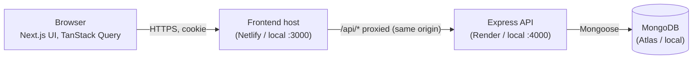
In production the frontend host forwards `/api/*` to the API, so the browser only ever sees one origin and the session cookie stays first-party (see decision 1). Locally the browser calls the API directly on another port of `localhost`.

### Request lifecycle (for example `GET /api/v1/patients?search=ami`)
1. **Browser:** a TanStack Query hook calls `api-client.ts`, which sends the request with the session cookie (`credentials: 'include'`). List filters live in the page URL, so the same URL always shows the same results.
2. **Express middleware, in order:** request logger (path only, never the query string, because search terms can be patient names) → Helmet security headers → CORS allow-list → `Cache-Control: no-store` → JSON body parser (10 kB limit) → cookie parser → rate limiter.
3. **Router:** `requireAuth` verifies the JWT in the cookie, then loads the user from MongoDB and checks the account is active and the token version is current. Write routes also pass `requireRole('admin')` and the CSRF checks.
4. **Validation:** a strict Zod schema parses the query (page, limit, allowed sort fields, filters). Unknown parameters are rejected with 400.
5. **Controller → service → query builder:** the controller is thin; the service holds the rules; the query builder converts validated input into a MongoDB filter (user text is only ever a *value*, never an operator).
6. **MongoDB:** the filter, sort and `skip/limit` run against indexes. Doctors for the returned page are resolved with one `$in` query, not one query per row.
7. **Response:** `{ "success": true, "data": [...], "pagination": {...} }`. Any thrown error goes to one central handler that returns `{ "success": false, "error": { "code", "message" } }` without internals.

### Data model
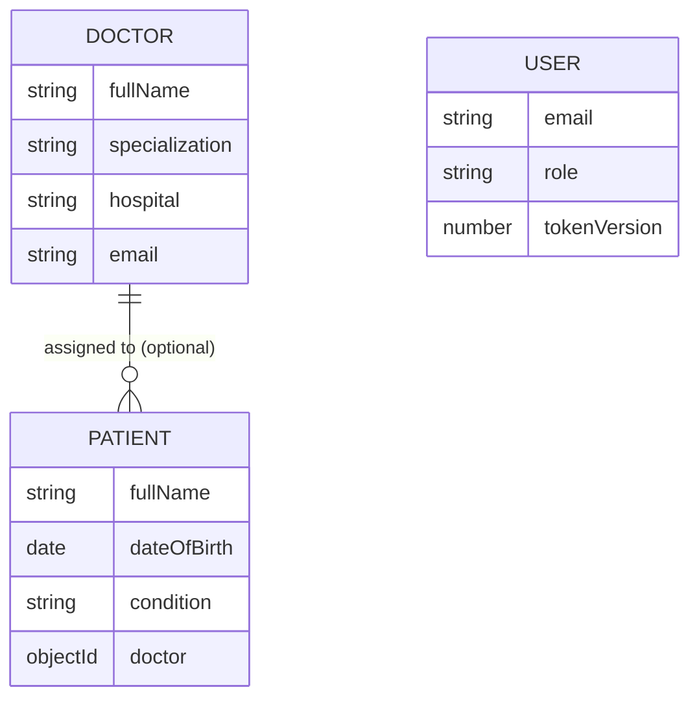
A patient stores one optional `doctor` reference (`null` = unassigned). Patient counts per doctor are computed with indexed queries, never stored, so they cannot drift. Removing a patient from a doctor only unassigns; deleting a doctor who still has patients returns `409 DOCTOR_HAS_PATIENTS` unless `?patients=unassign` is given, and patients are never deleted as a side effect.

### Dashboard data flow
Five endpoints (`overview`, `trends`, `doctor-statistics`, `condition-distribution`, `recent-activity`) share one date-range contract (UTC, half-open). Each runs a MongoDB aggregation that starts with `$match` on an indexed field, groups on the smallest set of fields, and only then joins (`$limit` before `$lookup`). The API zero-fills empty days/weeks/months, so the frontend renders exactly what it receives and charts never show misleading gaps.

### Authentication flow
Login verifies a bcrypt password hash and sets a signed JWT in an HttpOnly cookie, returning a separate CSRF token that the frontend keeps in memory only. On every page refresh the app calls `GET /auth/me`; a 200 restores the session and a 401 sends the user to the login page. Logout increments a per-user `tokenVersion`, which invalidates all of that user's older tokens on the server.

---

## Technical Decisions

Two decisions are explained in depth below. Each follows the same structure: context, options considered, decision, why, trade-offs and how it was verified.

### Decision 1: HttpOnly-cookie sessions with server-side revocation (instead of a JWT in localStorage)

**Context.** The API holds patient-related data, so the way the browser proves who it is matters more than convenience. The frontend and the API run on different origins (different ports locally, different hosts in production).

**Options.**
1. *JWT in `localStorage`, sent as a bearer header.* Simple, and avoids cookie and CSRF concerns. But any script that runs on the page, including one injected through a single XSS bug, can read and steal the token, and a stolen token works until it expires.
2. *Random session ID in a cookie, session stored in the database.* Easy to revoke, but needs a session collection with expiry cleanup.
3. *Signed JWT in an HttpOnly cookie, plus a version number on the user (chosen).*

**Decision.** The session is a signed JWT (HS256; issuer, audience and expiry are checked) stored in an `HttpOnly` cookie. The user document holds a `tokenVersion` that is copied into the token. On every request the API verifies the signature, loads the user, and requires the account to be active and the versions to match. The role is read from the database, never trusted from the token. CSRF is handled with an `Origin` allow-list on every mutation plus an `X-CSRF-Token` header containing an HMAC that the page keeps only in memory.

**Why.**
- JavaScript cannot read an `HttpOnly` cookie, so XSS cannot simply copy the credential out of the browser.
- Logout and password resets increment `tokenVersion`, so older tokens stop working immediately; a demoted or deactivated user loses access on their next request, not when the token expires.
- Because the cookie is attached automatically, CSRF has to be addressed explicitly; three layers (SameSite, Origin check, HMAC header) are used on purpose.

**Trade-offs.**
- One indexed `_id` read from MongoDB per request. This is cheap here and is what buys immediate revocation. With that read in place, a plain server-side session would also have been a valid design; the signed token's remaining benefit is that forged or expired requests are rejected before touching the database.
- No refresh tokens: users sign in again after the token expires (default 60 minutes).
- Cross-site cookies are fragile. With the frontend and API on different sites, the cookie needs `SameSite=None; Secure` and is a *third-party cookie* that Safari, Brave and some other browsers block. This was observed in deployment: login succeeded and the user was signed out immediately. The fix is a same-origin proxy: the frontend host forwards `/api/*` to the API (`API_PROXY_TARGET` in `frontend/next.config.ts`), the browser sees one origin, and the cookie can use `SameSite=Lax`.

**Verification.** Integration tests cover wrong password versus unknown email (identical responses), a deactivated user, logout invalidating the old cookie, a `tokenVersion` bump invalidating sessions, a deleted user losing access, CSRF success and failure, and viewer versus admin permissions. The proxy was verified in a production build and by the deployment owner; it was not part of the automated tests.

### Decision 2: Server-side search with prefix tokens and compound indexes (instead of a regular expression, or a text index)

**Context.** Doctors and patients must be searchable by name, specialization, hospital, condition, email and phone, and the lists must stay fast as they grow.

**Options.**
1. *Case-insensitive "contains" regular expression* (`/ami/i`). The most flexible, and the easiest to write. But a pattern that can match anywhere cannot use an index, so MongoDB scans every document, and passing raw user text into a regex is also a safety risk.
2. *MongoDB `$text` index.* Index-backed and supports stemming, but it matches whole words only, supports one text index per collection, and combines awkwardly with the other filters and sort orders used here.
3. *Normalized prefix tokens in an indexed array (chosen).*

**Decision.** Each document stores a `searchTokens` array built before every save: lowercase, accent-stripped words from the name, specialization, hospital, condition, plus the full email and digits-only phone. A multikey index covers that array. A search such as `ami kh` is split into terms, and each term becomes an *anchored, escaped* regular expression (`^ami`) that must match the start of some token. Terms are ANDed, and are capped in number and length. Sorting by name uses a separate normalized `nameSort` field with its own index, and only an allow-list of sort fields is accepted.

**Why.**
- An anchored prefix pattern can use the index (a bounded range scan) where a contains pattern cannot.
- Escaping and anchoring mean user text can never become a regex operator or a pathological pattern.
- Case- and accent-insensitivity is handled once when saving, not on every query.
- Lists end their sort with `_id`, so pagination never skips or repeats rows when sort values tie. List filters use compound indexes shaped like the queries, e.g. `(doctor, createdAt)` and `(condition, createdAt)`.

**Trade-offs.**
- Prefix search only: typing "mina" will not find "Amina". Substring search would need Atlas Search or n-grams.
- Writes do slightly more work (building tokens) and indexes cost storage and write time.
- Offset pagination (`skip`/`limit`) is simple and allows jumping to a page, but deep pages get slower, so limits (≤100 per page, maximum offset 50,000) are enforced.

**Verification.** `npm run explain` (run on a local MongoDB with 24 doctors and 320 patients) shows every list query using an index and not a collection scan; for example, patient prefix search examined 31 index keys and 12 documents to return 10, and the filter-by-doctor list used `doctor_1_createdAt_-1`. These sizes are too small to say anything about timings, so no performance claim is made beyond "uses the intended index". Integration tests cover regular-expression characters being treated literally, tie-stable pagination, accent-insensitive sorting, and rejection of operator payloads in query strings.

---

## Visual Evidence

Screenshots below were captured from a local run seeded with the synthetic demo data (`npm run seed:demo`) at 1280 px (desktop), 768 px (tablet) and 375 px (phone) wide, by `frontend/scripts/capture-screenshots.mjs`. The script also checks every page for sideways scrolling and console errors.

### Desktop (1280 px)
**Dashboard**

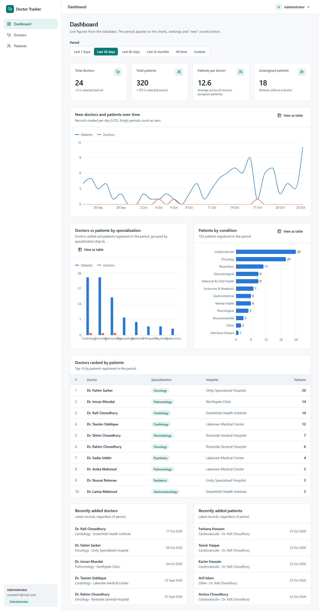

**Doctors list** (search, filters, sorting, pagination)

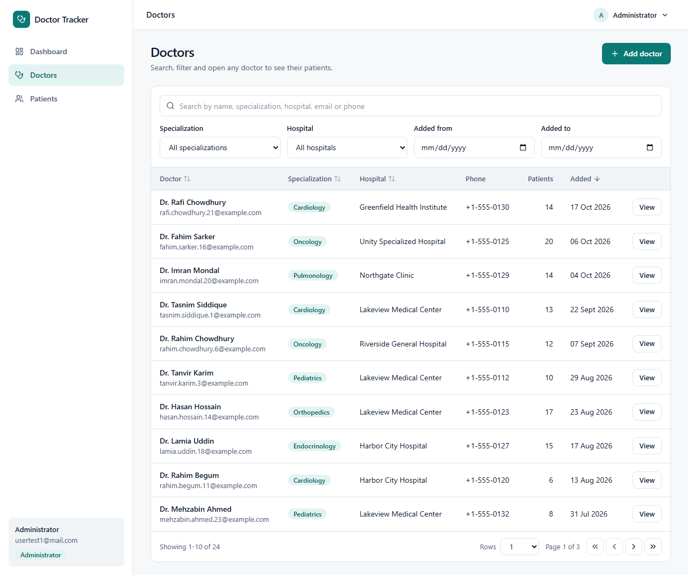

**Patients list**

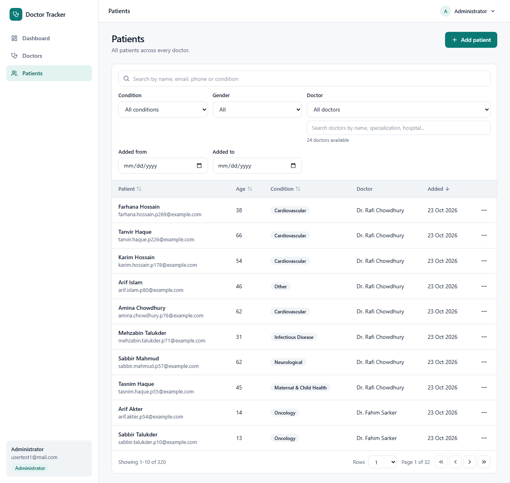

**Doctor detail** and **sign-in validation**

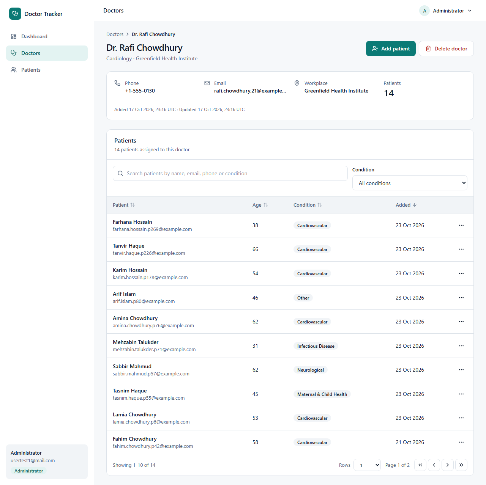

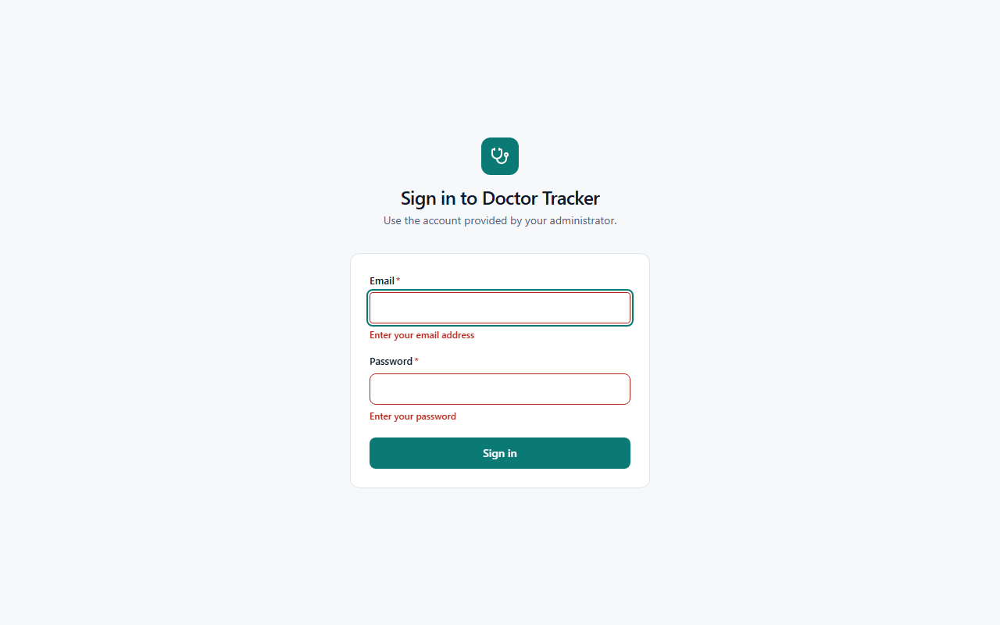

### Mobile (375 px)
| Dashboard | Doctors | Patients | Patient form validation |
|---|---|---|---|
| 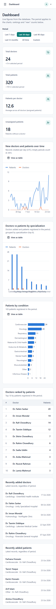 | 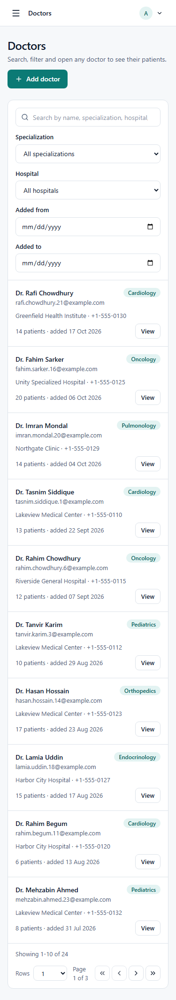 | 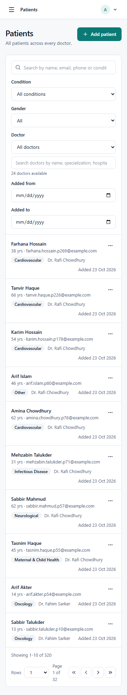 | 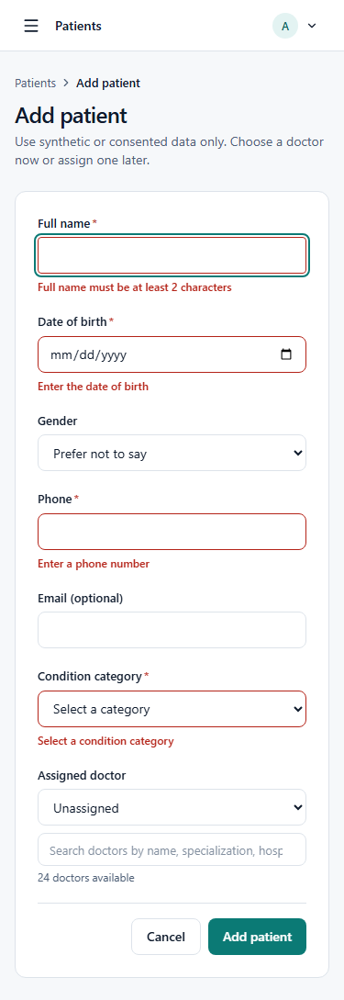 |

On narrow screens tables become card lists, and the navigation collapses into a menu.

### Tablet (768 px)
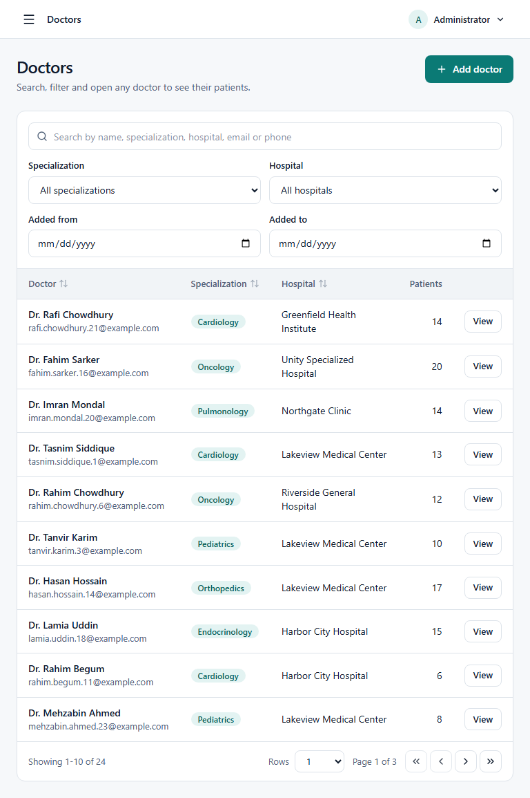

**Regenerate them** (with the app and API running, against synthetic data only):
```bash
cd frontend
npx playwright install chromium
BASE_URL=http://localhost:3000 EMAIL=you@example.com PASSWORD='...' node scripts/capture-screenshots.mjs
```
Output goes to `screenshots/<width>/<page>.png`. Set `SCALE=1` for smaller files (default is 2x for sharper images).

---

## Reference

### Tech stack
- **Frontend:** Next.js 16 (App Router), TypeScript, Tailwind CSS, React Hook Form + Zod, TanStack Query, Recharts, Radix UI, Lucide.
- **Backend:** Node 20+, Express 5, TypeScript, Mongoose 9, Zod, JWT, bcryptjs, Helmet, express-rate-limit, pino.
- **Tests:** Vitest (backend unit and integration, with an in-memory MongoDB; frontend with React Testing Library and MSW).

### Repository layout
```
backend/    Express API  (src/{config,models,validators,middleware,services,controllers,routes}, scripts/, tests/)
frontend/   Next.js app  (src/{app,components,features,hooks,lib,providers}, scripts/, tests/)
screenshots/  UI screenshots used above
render.yaml Render blueprint for the API
```

### Scripts
Root: `install:all`, `dev:backend`, `dev:frontend`, `lint`, `typecheck`, `test`, `build`.
Backend: `dev`, `build`, `start`, `test:unit`, `test:integration`, `seed:admin`, `seed:demo`, `explain`.
Frontend: `dev`, `build`, `start`, `lint`, `typecheck`, `test`.

### API
Base path `/api/v1`. Success: `{ "success": true, "data": ... }` (lists add `pagination`). Failure: `{ "success": false, "error": { "code", "message", "details?" } }`.

| Area | Endpoints |
|---|---|
| Auth | `POST /auth/login`, `POST /auth/logout`, `GET /auth/me` |
| Doctors | `GET, POST /doctors`; `GET, PATCH, DELETE /doctors/:id`; `GET /doctors/filters`; `GET /doctors/:id/patients`; `DELETE /doctors/:id/patients/:patientId` (unassign) |
| Patients | `GET, POST /patients`; `GET, PATCH, DELETE /patients/:id`; `GET /patients/filters` |
| Dashboard | `GET /dashboard/overview`, `/trends`, `/doctor-statistics`, `/condition-distribution`, `/recent-activity` |
| Health | `GET /health`, `GET /health/ready` |

An OpenAPI description is served at `/api/v1/openapi.json` outside production only.

### Security summary
HttpOnly JWT cookie with server-side revocation; role read from the database; no public registration; bcrypt with uniform login failures and rate limits (per IP and per IP+email); CSRF via Origin allow-list plus HMAC header; strict Zod validation on every input; Helmet; `Cache-Control: no-store`; logs contain no query strings or personal data; no secrets in the repository.

### Deployment (Netlify or Vercel + Render + Atlas)
`render.yaml` describes the API service.
1. **Atlas:** create an M0 cluster and a database user, and allow network access (free Render has no fixed IP, so this means `0.0.0.0/0` with a strong database password). Put a database name in `MONGODB_URI`.
2. **API on Render** from `backend/`: build `npm ci && npm run build`, start `npm start`, health check `/health`. Set `NODE_ENV=production`, `MONGODB_URI`, `JWT_SECRET`, `FRONTEND_URL` (the frontend's exact origin), `COOKIE_SECURE=true`, `TRUST_PROXY=1`, and `COOKIE_SAMESITE=lax` when using the proxy below.
3. **First admin:** run `npm run seed:admin` from your own machine with the same `MONGODB_URI`.
4. **Frontend host** from `frontend/`: set `API_PROXY_TARGET=https://<api-host>` and `NEXT_PUBLIC_API_BASE_URL=/api/v1`, then rebuild (public variables are read at build time).
5. **Check:** log in, refresh the page and confirm you stay signed in; a write request without the CSRF header must return 403.

Free Render instances sleep, so the first request can take 30 to 60 seconds; the UI shows a waking-up notice. Behind two proxies the per-IP rate limits see the frontend host's address for every visitor, which is acceptable for a demo.

### Verification status
| Item | Status |
|---|---|
| Backend typecheck, lint, build | verified locally |
| Backend unit tests (150) | passing locally |
| Backend integration tests (67) | 67/67 passed on a local MongoDB (run by the repository owner) |
| `seed:admin`, `seed:demo` (24 doctors, 320 patients), `explain` | run successfully on a local MongoDB (owner) |
| Frontend typecheck, lint, production build | verified locally |
| Frontend tests (52) | passing locally |
| Screenshots and responsive check (375/768/1280) | captured by the repository owner; the script reported overflow and console-error checks |
| Deployment (Netlify + Render + Atlas) | deployed and working per the repository owner; live URLs are not recorded here |

Query plans (local MongoDB, 24 doctors and 320 patients, from `npm run explain`):

| Query | Winning index | Keys / docs examined / returned |
|---|---|---|
| doctors: default list | `createdAt_-1__id_-1` | 10 / 10 / 10 |
| doctors: sort by name | `nameSort_1__id_1` | 10 / 10 / 10 |
| doctors: filter specialization | `specialization_1_createdAt_-1` | 3 / 3 / 3 |
| doctors: prefix search | `searchTokens_1` | 4 / 1 / 1 |
| patients: default list | `createdAt_-1__id_-1` | 10 / 10 / 10 |
| patients: of one doctor | `doctor_1_createdAt_-1` | 13 / 13 / 10 |
| patients: unassigned | `doctor_1_createdAt_-1` | 19 / 18 / 10 |
| patients: filter condition | `createdAt_-1__id_-1` | 30 / 30 / 10 |
| patients: prefix search | `searchTokens_1` | 31 / 12 / 10 |
| aggregation: top doctors (90 days) | `doctor_1_createdAt_-1` (covered) | 229 / 0 / 24 |
| aggregation: patient trend (90 days) | `createdAt_-1__id_-1` (covered) | 226 / 0 / 226 |
| aggregation: condition distribution (90 days) | `createdAt_-1__id_-1`, then fetch | 226 / 226 / 12 |

Timings at this size are not meaningful. Condition distribution fetches documents; a compound `{createdAt, condition}` index would cover it if the data grew.

### Known limitations
Prefix-only search; offset pagination (maximum offset 50,000); no refresh tokens (sign in again after expiry); no audit log; no password reset or user-management screen (accounts come from `seed:admin`); no end-to-end browser test suite; rate limits are shared per proxy address when deployed behind a proxy.

### Possible next steps
Cursor pagination; Atlas Search or n-grams for substring search; refresh tokens; an audit trail; user administration; an end-to-end Playwright test suite in CI.